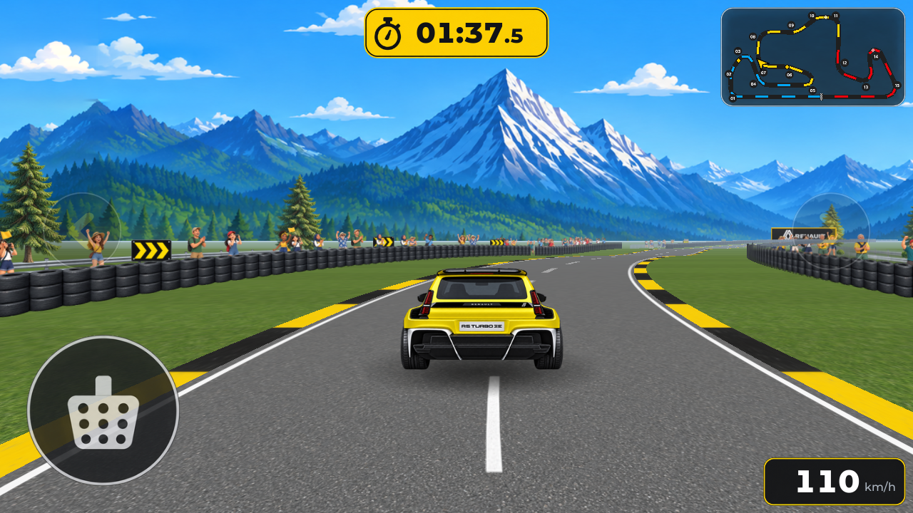

# Renault Racer

Renault Racer is a three-day Unity proof of concept exploring a racing giveaway experience for Renault’s new electric Renault 5 Turbo. The proposed campaign would invite participants to race for the best lap time, with a reward for the best result. This prototype demonstrates the visual direction and the initial gameplay.

### ▶ Play the browser demo: _link coming soon_

<!-- Replace the line above with the Netlify URL once the site/ folder is deployed. -->

> **Work in progress.** This prototype was made in three days. The driving mechanics are unfinished and still need tuning and optimization. It is a playable proof of concept, not a finished game, and the giveaway is a campaign concept, not a live competition.



## What is implemented

- One-lap time trial on a single circuit, with a start-light countdown, lap timer and finish screen
- Pseudo-3D road built procedurally from track segments, with pooled roadside sprites (crowds, tyre walls, chevrons, banners)
- Automatic acceleration, steering, brake and handbrake, with skid marks, tyre smoke and impact sparks
- Sector splits compared with the player’s personal best, stored locally in the browser
- Lap validation: checkpoints in order and plausible lap times, otherwise the lap is rejected
- Circuit-shaped minimap with the player’s position
- Keyboard and touch controls, a “rotate your phone” screen in portrait, and safe-area handling for notched phones
- Sound synthesised at runtime: motor, tyre squeal, impacts and countdown beeps
- Adaptive quality tiers for weaker devices
- Restart without reloading the page

The in-game interface is in Slovenian.

## Controls

| Action | Keyboard | Touch |
| --- | --- | --- |
| Start | Enter, or click **ZAČNI** | Tap **ZAČNI** |
| Steer | ← → or A / D | Left and right buttons |
| Brake | ↓, S or Space | Brake pedal |
| Handbrake | Shift | — |
| Restart | R | Tap after the finish |

The car accelerates automatically during a race.

## Where things are

| Folder | Contents |
| --- | --- |
| [`Assets/Scripts`](Assets/Scripts) | Game code: [`Vehicle`](Assets/Scripts/Vehicle), [`Track`](Assets/Scripts/Track), [`Race`](Assets/Scripts/Race), [`UI`](Assets/Scripts/UI), [`Input`](Assets/Scripts/Input), [`Effects`](Assets/Scripts/Effects), [`Audio`](Assets/Scripts/Audio), [`Core`](Assets/Scripts/Core) |
| [`Assets/Scripts/Editor`](Assets/Scripts/Editor) | Editor tools: build menu, scene wiring, measurement probes |
| [`Assets/Art/Resources`](Assets/Art/Resources) | Artwork: car, track, environment, effects, UI atlases and fonts |
| [`Assets/ScriptableObjects`](Assets/ScriptableObjects) | Game configuration and the handling profile |
| [`Assets/Scenes/Main.unity`](Assets/Scenes) | The single game scene |
| [`site/`](site) | The browser showcase: a short page plus the prebuilt Unity Web player in `site/demo` |

## Open it in Unity

1. Install **Unity 6000.6.0f1** with **Web Build Support**, via Unity Hub.
2. Clone this repository and add the folder in Unity Hub (**Add → Add project from disk**). Git must be installed, because one editor package is fetched from GitHub.
3. Open `Assets/Scenes/Main.unity` and press **Play**.

To make a production Web build, use **Renault Racer → Build Web — PRODUCTION (Brotli) + size audit**. It writes to `Builds/WebCurrent`. From the command line:

```
Unity -batchmode -quit -projectPath . -executeMethod RenaultRacer.EditorTools.ProductionBuild.RunFromCommandLine
```

The package `com.coplaydev.unity-mcp` in `Packages/manifest.json` is an editor-only development tool. It is not part of the game and can be removed.

## Hosting the browser demo

`site/` is a static site with no build step. The Unity build is Brotli-compressed with Decompression Fallback off, so the server must send `Content-Encoding: br`. [`site/_headers`](site/_headers) does this on Netlify, and [`netlify.toml`](netlify.toml) publishes `site/`. Its rules name the hashed build files exactly; update them after replacing `site/demo` with a new build.

## Credits and notices

- **Montserrat** font, © 2024 The Montserrat.Git Project Authors, licensed under the SIL Open Font License 1.1. The files in `Assets/Art/Resources/Fonts` are modified (instanced, subset and renamed) versions. See [`THIRD_PARTY_NOTICES.md`](THIRD_PARTY_NOTICES.md) and [`Assets/Art/Fonts/Montserrat-OFL.txt`](Assets/Art/Fonts/Montserrat-OFL.txt).
- Built with **Unity** 6000.6.0f1. Unity is a trademark of Unity Technologies.
- Renault, the Renault logo and Renault 5 Turbo are trademarks of Renault. This prototype is a campaign proposal, not an official Renault product.

No license is granted for the code or artwork in this repository unless stated above.
