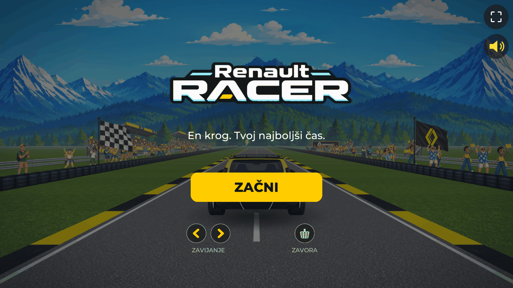
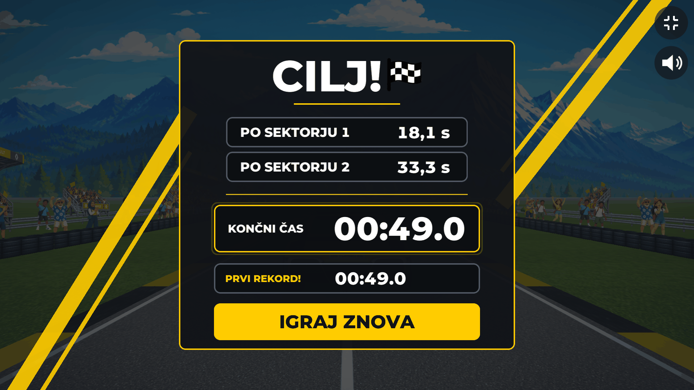

# Renault Racer — v1

A playable Unity Web racing game and portfolio/campaign concept: an unofficial idea for a lap-time giveaway built around the electric Renault 5 Turbo 3E. Race one circuit, set your best lap, beat it. It is not affiliated with or endorsed by Renault.

## [▶ Play live demo](https://renaultracer.netlify.app/)

[](https://renaultracer.netlify.app/)

<sub>The in-game interface is in Slovenian. The giveaway is a campaign concept, not a live competition.</sub>

## Highlights

- **Custom arcade handling**, not Unity physics: the car owns its world heading, with speed-dependent steering and surface-dependent grip. → [`CarSimulation.cs`](Assets/Scripts/Vehicle/CarSimulation.cs), [`HandlingProfile.cs`](Assets/Scripts/Vehicle/HandlingProfile.cs)
- **Pseudo-3D road** with hills, rebuilt each frame as one procedural mesh, on a 15-turn circuit. → [`RoadRenderer.cs`](Assets/Scripts/Track/RoadRenderer.cs), [`TrackLayout.cs`](Assets/Scripts/Track/TrackLayout.cs)
- **Animated vehicle**: perspective frames that follow steering input, up to the outermost L3/R3 view. → [`CarFrameSelector.cs`](Assets/Scripts/Vehicle/CarFrameSelector.cs)
- **Electric motor audio**, synthesised at boot rather than imported. → [`AudioDirector.cs`](Assets/Scripts/Audio/AudioDirector.cs)
- **Boost / lightning pickups** on the track, with an electric-arc burst around the car. → [`BoostPickups.cs`](Assets/Scripts/Effects/BoostPickups.cs), [`BoostPickupSet.cs`](Assets/Scripts/Race/BoostPickupSet.cs)
- **Responsive touch UI**: steering halves, brake button, safe-area insets and a rotate-your-phone gate. → [`TouchDriveInput.cs`](Assets/Scripts/Input/TouchDriveInput.cs), [`SafeAreaFitter.cs`](Assets/Scripts/UI/SafeAreaFitter.cs), [`RotateGate.cs`](Assets/Scripts/UI/RotateGate.cs)
- **Cumulative timing and browser persistence**: checkpoint splits compared with your previous best valid lap, saved in the browser only. → [`ResultsModel.cs`](Assets/Scripts/UI/ResultsModel.cs), [`PersonalBests.cs`](Assets/Scripts/Race/PersonalBests.cs)

## Screenshots

| Start | Gameplay | Results |
| :---: | :---: | :---: |
|  |  |  |
| Start screen | Racing the circuit | Results after a lap |

<sub>Start and gameplay are unedited frames from the production Web build. The results screen is from a first valid lap (so it shows plain checkpoint times and “PRVI REKORD!”, first record), driven by the project's built-in test rail in a local test build with identical game code.</sub>

The results screen shows two cumulative checkpoint times (checkpoint 1 and 2), each compared with the same checkpoint of your previous best valid lap, then the final time and your personal best. On a first attempt, or with older saved data that has no stored splits, a checkpoint shows its plain cumulative time instead of a comparison, and an unusable split shows `--`. Personal bests live only in your browser (PlayerPrefs, stored in IndexedDB on WebGL). There is no leaderboard and no backend.

## How it works

- **Fixed timestep simulation.** The game logic steps on its own fixed-step accumulator, and Unity 2D physics runs in script mode, so handling does not depend on frame rate. → [`FixedStepClock.cs`](Assets/Scripts/Core/FixedStepClock.cs), [`Bootstrap.cs`](Assets/Scripts/Core/Bootstrap.cs)
- **Pooled effects.** Roadside props and effects come from pools. → [`SimplePool.cs`](Assets/Scripts/Effects/SimplePool.cs)
- **Adaptive quality.** A starting tier is guessed from the browser's reported device memory and CPU cores. → [`QualityDirector.cs`](Assets/Scripts/Core/QualityDirector.cs)
- **Production Web build.** Brotli-compressed `.wasm` and `.data`; the framework ships as a plain `<hash>.framework.js` because the host re-compressed a pre-compressed one. → [`ProductionBuild.cs`](Assets/Scripts/Editor/ProductionBuild.cs)
- **Bounded WASM heap.** 128 MB initial, 384 MB maximum. → [`ProjectSettings.asset`](ProjectSettings/ProjectSettings.asset)

**Mobile:** touch controls and layout are implemented; there has been no formal device performance testing.

## Controls

| Action | Keyboard | Touch |
| --- | --- | --- |
| Start | Click **ZAČNI** | Tap **ZAČNI** |
| Steer | ← → or A / D | Left / right half of the screen |
| Brake | ↓, S or Space | Brake button |
| Handbrake | Shift | Hold brake and a steering half together |
| Pause | Esc, or the pause button | Pause button |
| Sound, fullscreen | On-screen sound and fullscreen buttons | Same buttons |
| Restart | R, or **IGRAJ ZNOVA** after the finish | **IGRAJ ZNOVA** after the finish |

The car accelerates automatically. The interface language is Slovenian.

## Open it in Unity

1. Install **Unity 6000.6.0f1** with **Web Build Support** (Unity Hub).
2. Clone this repository and add the folder in Unity Hub (**Add → Add project from disk**). Git must be installed, because one editor package is fetched from GitHub.
3. Open `Assets/Scenes/Main.unity` and press **Play**.

For a production Web build use **Renault Racer → Build Web — PRODUCTION (Brotli) + size audit**, or:

```
Unity -batchmode -quit -projectPath . -executeMethod RenaultRacer.EditorTools.ProductionBuild.RunFromCommandLine
```

`com.coplaydev.unity-mcp` in `Packages/manifest.json` is an editor-only development tool, not part of the game.

## Repository layout

| Folder | Contents |
| --- | --- |
| [`Assets/Scripts`](Assets/Scripts) | [`Vehicle`](Assets/Scripts/Vehicle), [`Track`](Assets/Scripts/Track), [`Race`](Assets/Scripts/Race), [`UI`](Assets/Scripts/UI), [`Input`](Assets/Scripts/Input), [`Effects`](Assets/Scripts/Effects), [`Audio`](Assets/Scripts/Audio), [`Core`](Assets/Scripts/Core), [`Web`](Assets/Scripts/Web), [`Editor`](Assets/Scripts/Editor) |
| [`Assets/Art/Resources`](Assets/Art/Resources) | Artwork: car, environment, effects and UI |
| [`Assets/ScriptableObjects`](Assets/ScriptableObjects) | Game configuration and handling profiles |
| [`site/`](site) | Landing page and the prebuilt Web player (`site/demo`), with Brotli headers in [`site/_headers`](site/_headers) |
| [`docs/`](docs) | README screenshots |

## Credits and notices

- **Montserrat** font, © 2024 The Montserrat.Git Project Authors, SIL Open Font License 1.1. The bundled files are modified (instanced, subset, renamed). See [`THIRD_PARTY_NOTICES.md`](THIRD_PARTY_NOTICES.md) and [`Assets/Art/Fonts/Montserrat-OFL.txt`](Assets/Art/Fonts/Montserrat-OFL.txt).
- Built with **Unity** 6000.6.0f1. Unity is a trademark of Unity Technologies.
- Renault, the Renault logo and Renault 5 Turbo are trademarks of Renault. This is an unofficial concept, not an official Renault product, and is not affiliated with or endorsed by Renault.

No license is granted for the code or artwork in this repository unless stated above.
